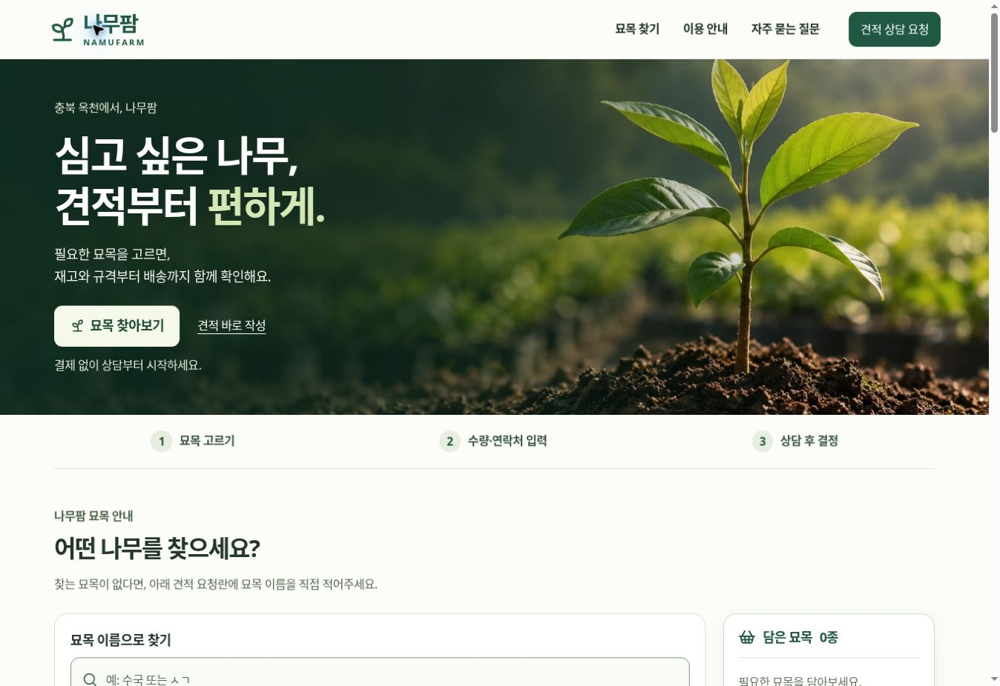
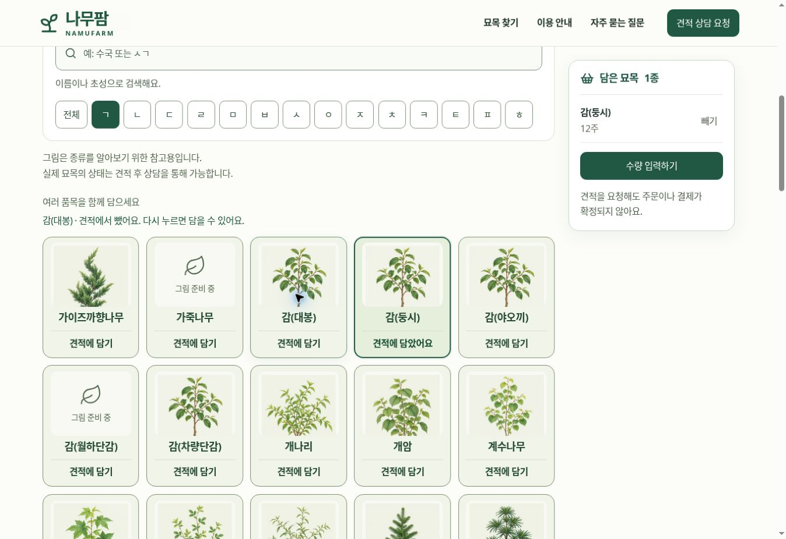
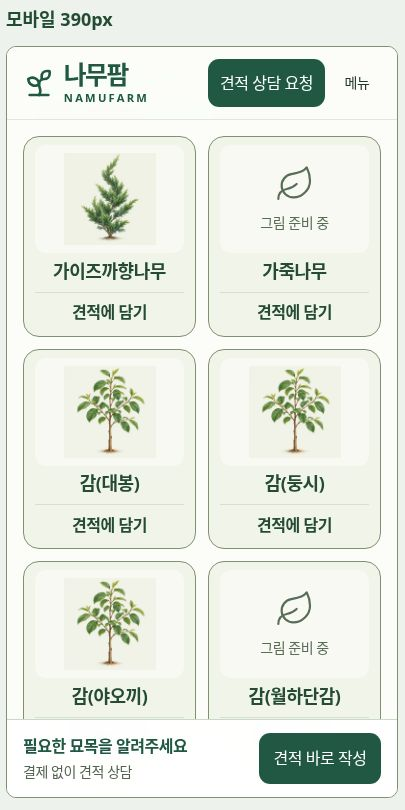

# 묘목 목록·견적 화면 구현 기록

## 범위와 보존 계약

- 홈페이지 전용 변경이다. PC·Android 프로그램과 Apps Script는 변경하지 않는다.
- 기존 186개 품목번호·이름·초성을 유지한다. 그림 연결은 별도 manifest로 관리한다.
- 수량은 모든 입력·선택 목록·합계·최종 확인에서 **주**로 표시한다.
- 견적 상담 접수는 주문·결제 확정이 아니다. 판매자가 재고·규격을 확인하고 공식 견적서를 수동 작성한다.
- `/api/config`, `/api/quote-requests`, 엄격한 요청 스키마, 암호화·Google Sheet 연동, 접수번호 검증을 유지한다. 화면용 품목번호나 이미지 정보는 접수 payload에 추가하지 않는다.
- 응답을 잃은 요청은 기존 UUID와 원문을 재사용한다. 결과가 불확실할 때 입력을 잠그며, 409 충돌은 새 번호를 만들어 우회하지 않고 전화 확인을 안내한다.

## 반응형 사용 흐름

하나의 React 화면과 같은 입력 상태를 사용한다. 별도 모바일 URL이나 기기 감지 분기는 두지 않는다.



1. 첫 화면에서 `묘목 찾아보기` 또는 `견적 바로 작성`을 선택한다.
2. 처음에는 `ㄱ` 목록을 표시한다. 이름·초성 검색은 전체 목록에서 찾으며 검색을 지우면 `ㄱ`으로 돌아간다. 초성 버튼을 누르면 첫 글자로 좁힌다.
3. 카드 전체를 한 번 누르면 담고 다시 누르면 뺀다. 해제하면 `견적에 담기`로 돌아오며 스크롤을 양식으로 강제 이동하지 않는다. 같은 이름을 직접 여러 줄 입력했어도 카드에서 해제하면 모두 빠진다. 잘못 뺀 품목은 입력한 수량·규격과 함께 되돌릴 수 있다.
4. PC는 오른쪽 담은 목록, 모바일은 하단 버튼으로 수량 입력란에 간다.
5. 수량·성함·전화번호·시군구를 입력한다. 희망 규격은 항상 펼쳐진 입력란이며 요청사항과 함께 선택 항목이다. 목록 밖 이름을 직접 추가할 수 있다.
6. 공식 견적서가 필요한 경우에만 받는 방법과 수신인을 펼친다. 이메일 선택 시에만 이메일을 필수로 받는다. 설명과 `견적서 예시 보기`는 항상 읽을 수 있다.
7. 잘못된 입력은 각 칸 아래와 오류 목록에 표시하고, 화면상 첫 오류 칸으로 이동한다. 내용 확인창에서 묘목·수량·연락처·견적서 선택을 다시 읽는다.
8. 서버가 유효한 접수번호와 날짜를 반환한 경우에만 완료한다. 번호 복사, 한국시간 접수일시, 상담 연락처 끝 네 자리와 다음 안내를 표시한다.

기존 확정 사항인 카드의 초성·더하기 표시 제거, `견적에 담기`/`견적에 담았어요`, 제목 옆 품목 수 제거, 직접 입력 안내 문장을 유지한다.

최근 보완에서는 초성 버튼 사용 안내와 `전체 묘목 186종` 표시를 삭제했다. 그림 안내를 요청한 두 문장으로 나누고, 하단 전화 상담에 `043-732-0980 / 010-4446-0304`를 각각 통화 가능한 링크로 표시한다.



## 크기·색상 기준

- 기본 본문·입력 글자 18px, 안내·라벨·버튼 16px 이상을 기본으로 한다. rem을 사용해 글씨 설정을 따른다.
- 입력란 56px 이상, 일반 버튼·초성 버튼 48px 이상, 주요 버튼 56px 이상이다.
- 카드 그림 틀은 약 108–112px 높이, 이름 18px, 담기 문구 16px이다. 그림 틀의 크기는 유지하고 안쪽에 8px 여백을 둔다. 이미지의 비율을 유지해 틀 안에 전체를 맞추며 이름을 생략하거나 고정 높이로 자르지 않는다.
- 모바일 기본 2열, 공간이나 글자 크기가 부족하면 1열로 바뀐다. PC는 가용 폭에 맞춘 카드 격자와 선택 목록을 함께 배치한다.
- 320px/390px 및 320px의 루트 글씨 200%를 별도 프레임에서 검토한다. 이 검토는 실제 Android/iOS의 OS 글자 설정·화면 낭독기 검사를 대체하지 않는다.
- 기본 글자 `#24372e`/배경 `#fcfdf9` 대비 12.38:1, 안내 `#526350`/흰색 6.44:1, 주요 버튼 `#205844`/흰색 8.27:1이다. 입력 경계 3.43:1, 카드 경계 3.03:1, 초성 버튼 경계 3.19:1이다.
- 큰 글씨에서 패딩만 함께 커져 입력 공간을 잠식하지 않도록 모바일 입력 패널의 여백을 제한한다. 긴 한국어·이메일·확인번호는 영역 밖으로 넘기지 않는다.
- 확인창은 모바일에서 화면 전체 높이를 사용하고 내부 스크롤한다. 키보드 입력 중에는 하단 버튼을 숨긴다. reduced-motion을 존중한다.

## 그림 연결과 제작

이번 반영에서는 186개 품목을 모두 연결 검사했다. 140개 품목은 123개의 그림 파일을 사용하며, 명칭·형질 확인이 필요한 46개 품목은 그림을 보류한다. 보류해도 해당 품목의 검색·견적 담기는 사용할 수 있다.

`lib/species-illustrations.json`의 키는 변경하지 않는 원본 품목번호다. 각 항목에 `src`, 공유 그룹 `group`, `status`, `references`, 판단 범위 `note`를 둔다. 연결된 그림은 묘사 대상인 `depictedTaxon`과 잎·수형·꽃 표현 범위인 `artworkScope`도 기록한다. `illustrated`만 실제 그림을 표시한다. `pending`이나 파일 로딩 실패는 이름과 중립적인 `그림 준비 중` 상태를 표시한다.

공통 미술 방향은 옅은 바탕의 간결한 식물 일러스트, 녹색 중심의 색감, 동일한 카드 안의 여백과 비율이다. 어린 잎·가지·수형을 중심으로 하며 풍성한 열매, 수확량, 공급 규격을 약속하는 그림은 사용하지 않는다. 꽃이 필요한 구분 자료도 해당 종을 알아보는 참고 표현으로 제한한다. 실제 납품 묘목·품종 인증 사진이 아니다.

종·속 수준의 형태를 공유할 수 있는 품목은 동일 파일을 연결한다. 품종마다 과형·꽃색·무늬·접목 형태가 다르면 개별 자료를 확인한 후 교체한다. 판매명만으로 정체를 확정할 수 없는 37개 항목은 학명·농원 품종표·실물 사진을 확인할 때까지 보류한다. 추가로 유통명의 대상 식물, 가시 없는 형질, 실제 잎 색·무늬 등 핵심 표현을 확인하지 못한 항목은 `docs/species-visual-review.json`에 기록해 보류한다. 예를 들어 무늬호랑가시를 일반 녹색 호랑가시 그림으로 대신하지 않는다.

이미지는 AI로 생성한 뒤 형태를 육안 검수하며, 판단에 사용한 공신력 있는 자료 URL과 확인 한계를 항목별로 기록한다. 검수에서 형태가 잘못된 그림은 다시 제작하거나 보류한다. 데이터·이미지 테스트는 식물학적 정확성이나 실제 납품 상태를 자동 인증하지 않는다.

모바일 파일은 384×384 WebP이며 파일당 60KB 미만을 검증한다. 표시 크기를 예약해 화면 밀림을 줄이고, 첫 6개 이외에는 lazy loading과 비동기 디코딩을 사용한다. 최초 24개 카드만 표시하며 검색은 186개 전체에 적용한다. 새로운 그림은 새 경로/버전으로 교체해 오래된 캐시와 혼동하지 않게 한다.

모든 카드의 그림 틀은 공통 flex 배치로 중앙 정렬한다. 이전 grid의 자동 최소 행 크기가 이미지 너비를 따라 정사각형으로 늘어나 고정 높이 밖의 밑동을 가리는 문제를 해결했다. 이미지의 최소 너비·높이를 0으로 허용하고 `object-fit: contain`으로 전체 그림을 맞춘다. 보류 그림도 같은 틀과 여백을 사용한다.

PC와 390px 모바일 프레임에서 186개 카드를 펼쳐 확인했으며, 그림이 있는 140개 모두 이미지 요소가 그림 틀 안에 들어왔다. 320px와 루트 글씨 200% 프레임의 기본 ㄱ 목록도 그림 잘림·가로 넘침이 없었다. 선택한 카드에서도 전체 그림이 유지됐다. 이 검사는 화면 배치 검증이며 실제 스마트폰의 모든 브라우저를 검증한 것은 아니다. 검증용 프레임 페이지는 배포에서 제외했다.



출처·판단 메모를 포함한 원본 manifest는 관리용이다. 화면에서는 `lib/species-illustration-index.json`의 품목번호와 경로만 읽는다. 원본을 수정한 뒤 `node scripts/sync-species-illustrations.mjs`로 이 작은 색인을 다시 만든다. 테스트에서 두 파일의 일치를 확인하므로 오래된 색인이 통과하지 못한다.

추가 교체는 다음 순서로 진행한다.

1. 원본 품목번호를 확인하고, 명칭·무늬·가시 등 보류 사유가 있으면 농원의 품종표와 실물 사진을 먼저 확보한다.
2. 종이나 속 수준에서 공유 가능한 특징과 품종별로 다른 특징을 구분해 manifest의 출처와 `note`에 남긴다. 납품 규격을 그림으로 보장하지 않는다.
3. 통일된 미술 방향으로 제작한 뒤 잎 모양·배열·가지·덩굴·가시를 검수한다. 증거가 부족하면 `pending`과 빈 `src`를 유지한다.
4. 검수한 WebP를 새 파일명으로 저장하고 해당 품목번호에 연결한다. 보류를 해제할 때는 해당 검토 목록의 항목도 근거에 따라 갱신한다.
5. 작은 색인을 재생성하고 테스트·모바일 카드 표시를 확인한 후 커밋·배포한다.

## 검증과 운영 확인

```sh
node node_modules/typescript/bin/tsc --noEmit --incremental false
node --test tests/*.test.mjs
```

연결 검증 범위는 품목번호 전수 매핑, 명칭 보류 37개와 추가 보류 9개 유지, WebP 파일 존재·용량, 카드 담기·해제·다시 담기·20종 제한·입력 오류 위치, 엄격한 API 계약, 실제 WebCrypto 암복호화, 요청 바인딩, 재시도 fingerprint, 서버 접수번호와 한국 날짜 검증이다. 홈페이지 테스트 19개와 기존 Apps Script 테스트 52개가 통과했다. Apps Script 테스트에는 동일 UUID 재전송의 단일 Sheet 행, 저장 실패 시 성공 응답 금지, 409 충돌, 이메일 선택, 보유기간 처리가 포함된다.

로컬 전용 가상 응답 화면으로 503 응답 유실 뒤 동일 UUID·입력 원문으로 재확인, 유효한 응답 뒤 접수번호·한국시간 표시와 번호 복사, 409 충돌 시 재전송·수정 차단 및 전화 안내를 확인했다. 이 검증 페이지와 가상 API는 커밋·배포 산출물에서 제거한다.

브라우저에서는 이름·초성 검색, 여러 품목 담기, 수량 입력, 필수 오류, 공식 견적서/이메일, 최종 확인·뒤로 수정, 작은 화면·큰 글씨의 가로 넘침을 확인한다. 운영 시트에 검증용 가짜 요청을 전송하지 않는다. 따라서 실제 운영 비밀 설정을 사용한 Google Sheet 저장·판매자 앱 수신·문자/이메일 발송은 이 화면 검증의 완료 항목으로 주장하지 않는다.

배포 후 운영자가 연결 점검을 할 때에는 기존 테스트 모드 절차에 따라 테스트 표시가 붙은 가상 정보로 요청하고, 접수번호·시트 저장·판매자 요청함을 대조한다. 실제 고객에게 견적서를 자동 발송하는 단계는 추가하지 않았다.
